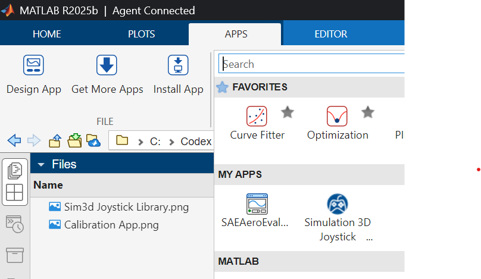

# Simulation 3D Joystick Calibrator

<!-- MATLAB Online badge intentionally disabled. -->

## Overview

Simulation 3D Joystick Calibrator creates one reusable calibration for a USB
joystick, RC controller, or flying stick. The app calibrates the physical
Roll, Pitch, Yaw, and Throttle controls once. The same saved configuration can
then drive the Fixed-Wing, Multirotor, or Helicopter input block supplied with
the toolbox.

The physical-axis calibration remains reusable across all three blocks.
Editable output limits in the app are applied by the Fixed-Wing block, which
allows direct mapping to control-surface ranges. The Multirotor and Helicopter
blocks intentionally retain normalized output contracts.

| Calibration dashboard | Simulink&reg; block library |
| :-------------------: | :--------------------: |
|  |  |

## Key Features

- One shared four-control calibration for all supported aircraft blocks
- Live raw-channel and calibrated-output bar charts
- Automatic rest-position, noise, channel, and travel-range capture
- Per-control direction verification and reverse selection
- Editable channel, raw range, deadband, reverse, and Fixed-Wing output limits
- Configuration save and load using a versioned MAT-file schema
- Support for controllers reporting between 4 and 64 analog axes
- Fixed-Wing, Multirotor, and Helicopter Simulink output contracts
- Dedicated mask artwork for each supplied library block

## Getting Started

### 1. Install the toolbox

1. Download `Simulation_3D_Joystick_Calibrator.mltbx`.
2. Double-click the file or install it from the MATLAB&reg; Add-On Manager.
3. Confirm that **Simulation 3D Joystick Calibrator** appears on the MATLAB
   Apps tab.
4. Confirm that **Simulation 3D Joystick Calibrator** appears in the Simulink
   Library Browser.

The single `.mltbx` installs the app, MATLAB services, command-line entry
point, documentation, and automatically registered Simulink library.

### 2. Launch the App

Open the app from the MATLAB Apps tab 



or run:

```matlab
Simulation3DJoystickCalibrator
```

### 3. Calibrate the Controller

1. Connect the controller and select its runtime Device ID.
2. Click **Connect**.
3. Center Roll, Pitch, and Yaw, place Throttle at rest, and click
   **Center & hold**.
4. Sweep each requested control through its complete travel.
5. Review the raw-channel and calibrated-output bar charts.
6. Set **Reverse** where necessary and confirm each control.
7. For Fixed-Wing use, edit **Output Min** and **Output Max** to match the
   required control-surface and throttle ranges.
8. Save the shared calibration MAT-file.

During an incomplete calibration, an unswept control can temporarily retain
the same channel as a control that was just identified. Both calibrated-output
bars move in that state so the shared assignment is visible. Sweeping the
remaining control excludes channels that are already calibrated, and saving
still requires four unique channel assignments.

### 4. Use the Calibration in Simulink

1. Open the Simulink Library Browser.
2. Locate **Simulation 3D Joystick Calibrator**.
3. Add the block for the required aircraft type.
4. Open the block mask and load the saved calibration file.
5. Select the runtime joystick Device ID.
6. Connect the output bus to the flight-control or vehicle model.

You can also open the library from MATLAB:

```matlab
open_system("Simulation3DJoystickCalibratorLibrary")
```

## Simulink Blocks

| Block | Output bus elements | Intended use |
| --- | --- | --- |
| `Calibrated Fixed-Wing Input` | `Aileron`, `Elevator`, `Rudder`, `Throttle` | Uses the saved per-control Output Min and Output Max values |
| `Calibrated Multirotor Input` | `RollCmd`, `PitchCmd`, `YawCmd`, `ThrottleCmd` | Normalized multirotor attitude or rate commands |
| `Calibrated Helicopter Input` | `LateralCyclic`, `LongitudinalCyclic`, `Pedals`, `Collective` | Conventional helicopter pilot controls |

## Output Range Behavior

- The Fixed-Wing block uses the `outputMin` and `outputMax` values saved for
  each control. Centered controls must include zero in their output range.
- The default Fixed-Wing block ranges are Aileron `[-15, 15]` degrees,
  Elevator `[-25, 25]` degrees, Rudder `[-20, 20]` degrees, and Throttle
  `[0, 1]`.
- The Multirotor block always outputs RollCmd, PitchCmd, and YawCmd in
  `[-1, 1]`, and ThrottleCmd in `[0, 1]`.
- The Helicopter block always outputs LateralCyclic, LongitudinalCyclic, and
  Pedals in `[-1, 1]`, and Collective in `[0, 1]`.

## Controller Support

- Controllers must expose at least four analog axes.
- Up to 64 analog axes are supported.
- Roll, Pitch, Yaw, and Throttle can use any four distinct channels.
- Additional axes remain visible in the raw-channel preview.
- Buttons and POV hats are not calibrated in this release.
- The connected hardware and operating system must be supported by
  `sim3d.io.Joystick`.

## Requirements

- MATLAB R2025b or later
- Simulink
- Simulink 3D Animation&trade;
- A controller recognized by `sim3d.io.Joystick` for hardware operation

## Documentation

Click **Overview** in the app for the complete installation, calibration, and
Simulink workflow.

## License

See [`license.txt`](./license.txt).

## Support

Use the repository issue tracker for questions, bug reports, and feature
requests.

Copyright 2026 The MathWorks, Inc.
